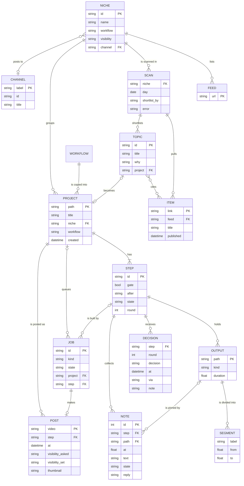
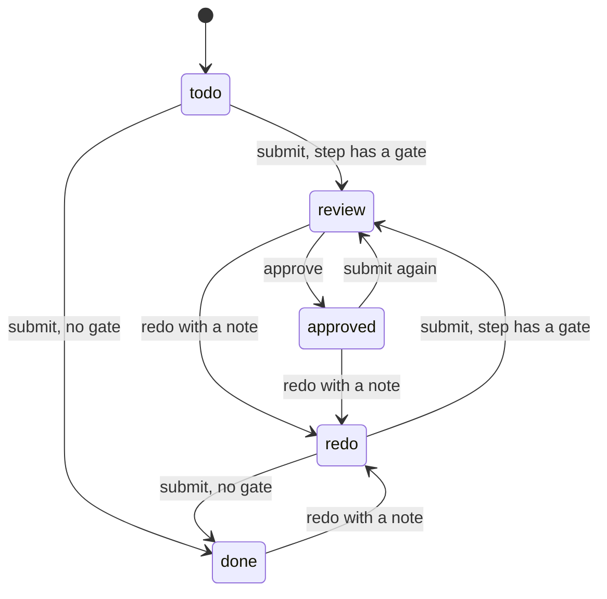

# Design: the first build

Status: draft, waiting for the owner's approval. Written 25 November 2026,
and revised the same day after the owner's decisions.

[PRD.md](./PRD.md) says what gets built and why. This says how. M1 is
designed in full. M2 to M5 are designed far enough that M1's files don't have
to change shape later.

## The shape

There's no daemon, no database and no socket. The state is files. Every way
in runs the same operations from one Rust library. The only port the app
ever opens is on 127.0.0.1, for the minutes a Google sign-in takes.

```
Claude Desktop ──stdio──▶ mockingbird-studio mcp ───┐
a terminal ─────────────▶ mockingbird-studio <op> ──┤
the window (Tauri) ─────▶ invoke("op", …) ──────────┼─▶ core ─▶ project.toml
launchd, at scan time ──▶ mockingbird-studio scan ──┤           ~/.mockingbird-studio/
                          mockingbird-studio runner ┘
                            │  (detached, lives while there are jobs)
                            ├─▶ mockingbird mcp · ffmpeg · the tools you declared
                            └─▶ YouTube's API, for an upload you approved
```

Why files and no daemon:

- The README's first complaint is that state lived in chat. A file in the
  project folder is state you can read, copy and put under git.
- "Every step works with the window closed" comes free. A test runs the
  binary against a temp folder.
- Claude Desktop starts the MCP server as its own child and stops it when it
  quits. Jobs can't live there, so they need a separate process anyway. A
  runner that exists only while jobs do is less to keep alive than a daemon.

The cost is more than one process writing the same file. Every write takes
an advisory lock on `<file>.lock`, reads, changes, writes a temp file and
renames it over the original. If the window ever needs progress faster than
it can poll, or writes start to contend, that's the point to add a daemon,
and not before.

## Words

| Word | Means |
|---|---|
| Niche | A subject you make videos about: a name, the feeds you listed, a default workflow, a visibility, and the channel it posts to. |
| Channel | A YouTube channel you signed in to, known to the app by a label. |
| Feed | One RSS or Atom address you typed in. |
| Scan | One pull of a niche's feeds. |
| Item | One entry from a feed: title, link, date. |
| Topic | A candidate video on a scan's shortlist. It points at the items behind it. |
| Project | One video. One folder with a `project.toml`. |
| Workflow | A list of steps with gates. It's copied into the project when the project is made. |
| Step | One stage of a project: research, script, voice, and so on. |
| Output | A file the agent submitted for a step. |
| Segment | A named stretch of an audio or video output, such as a chapter or a shot. |
| Note | Something you wrote about a step, a file, or a moment in a file. |
| Decision | Your approve or redo on one round of a step. |
| Job | A long task the app runs for you: a render, a preview copy, a declared tool, an upload. |
| Post | One video on YouTube that came from a project: its id, link and what Google did with it. |

## Entities



## Where each one is stored

| Entity | File | Written by | From |
|---|---|---|---|
| Project, Step, Output, Segment, Note, Decision | `<project>/project.toml` | any process, under the lock | M1 |
| The list of project folders | `~/.mockingbird-studio/config.toml` | any process, under the lock | M1 |
| Job | `~/.mockingbird-studio/jobs/<id>/job.toml` and `log.txt` | the caller creates it, then only the runner | M2 |
| Declared tools | `~/.mockingbird-studio/config.toml` | you | M2 |
| Niche, Feed, Channel | `~/.mockingbird-studio/config.toml` | any process, under the lock | M3 |
| The Google token | the macOS Keychain | the sign-in | M3 |
| Post | `<project>/project.toml` | the upload job, under the lock | M3 |
| Scan, Item, Topic | `~/.mockingbird-studio/scans/<niche>/<day>.json` | the scan | M4 |
| Workflow | built in, or `~/.mockingbird-studio/workflows/<name>.toml` | you | M5 |

`MOCKINGBIRD_STUDIO_HOME` moves `~/.mockingbird-studio`. Tests set it to a
temp folder.

The app writes these files with a serializer, so comments typed into them by
hand don't survive the next write.

## A project folder

```
<project>/
  project.toml
  research/ script/ voice/ look/ sound/ assets/ previews/ shorts/ film/
  thumbnail/ description/ upload/
  .studio/        the app's own files: preview copies and text rounds, from M2
```

One folder per step. An output's path is relative to the project folder and
has to resolve inside it. A path that leaves the folder, through `..` or a
symlink, is refused.

### project.toml, schema 1

```toml
schema = 1
title = "Example video"
niche = "ai-news"            # optional
workflow = "explainer"
created = 2026-11-25T09:00:00Z
next_note = 3

[[step]]
id = "script"
gate = true
after = ["research"]
state = "redo"               # todo | review | redo | approved | done
round = 1

  [[step.output]]
  path = "script/script.md"
  kind = "text"              # text | pdf | image | audio | video | other

[[step]]
id = "previews"
gate = true
after = ["voice", "look", "assets"]
state = "review"
round = 1

  [[step.output]]
  path = "previews/ch1.mp4"
  kind = "video"
  duration = 61.2            # from M2
  segments = [               # from M2
    { label = "Cold open", from = 0.0, to = 21.4 },
  ]

[[decision]]
step = "script"
round = 1
decision = "redo"            # approved | redo
at = 2026-11-25T09:40:12Z
via = "window"               # window | cli | mcp
note = "The cold open is slow."

[[note]]
id = 1
step = "script"
path = "script/script.md"    # optional
text = "Line 12: say where the number comes from."
created = 2026-11-25T09:39:50Z
round = 1
state = "open"               # open | done

[[note]]
id = 2
step = "previews"
path = "previews/ch1.mp4"
at = 4.0                     # seconds into the file, optional
text = "This card stays up too long."
created = 2026-11-25T11:02:00Z
round = 1
state = "done"
reply = "Cut to 2.5 s in round 2."

[[post]]                     # from M3
step = "upload"
round = 1
at = 2026-11-25T18:30:00Z
job = "20261125-182512-7f3a"
video = "VIDEO_ID"
url = "https://youtu.be/VIDEO_ID"
channel = "main"
visibility_asked = "public"
visibility_set = "private"   # what Google's reply said
thumbnail = "set"            # set | refused | failed
```

Times are RFC 3339 with an offset, written as quoted strings
(`created = "2026-11-25T09:00:00Z"`) so they come out as plain strings in
JSON too. Reading also takes a bare TOML datetime. Keys the app doesn't
know, at any level, are kept when it writes the file, and it won't change a
file whose `schema` is newer than its own. `decision` and `post` rows are never
edited or removed, so the file is the record AGENTS.md asks for: every
approval with its time, and everything that was posted because of one.

A step's `output` list is the current round's. Older rounds stay in
`decision` and `note`. From M2, `submit` also copies each text output to
`.studio/rounds/<step>/<round>/<path>`. `round_text` (project, step, path,
round?) returns that copy and a line diff against the last earlier round
that kept the same file, and the window shows the diff, so a text preview
is always what was submitted, not what's on disk now.

### Step states



Rules:

- `submit` adds one to `round` and replaces the output list.
- `submit` is refused unless every step in `after` is `approved` or `done`.
  This is what makes a gate hold. The app can't stop an agent from writing
  files early, but it won't take them, and from M2 it won't start a job for
  that step.
- `approve` works only from `review`. `redo` needs a note.
- Submitting to an approved step puts it back in `review`. A new round needs
  a new yes.
- When a step is sent back for a redo, or an approved step is submitted
  again, every step that comes after it (through `after`, directly or not)
  and is past `todo` moves to `redo`. Each gets a `redo` decision whose note
  names the step that caused it, with the same `via`. Work built on the old
  version has to be looked at again.

### The built-in workflow

`explainer`, taken from the README's steps and the 24 November run. The
gates and the order are a first guess for the owner to correct.

| Step | Gate | After |
|---|---|---|
| research | yes (the topic) | |
| script | yes | research |
| voice | yes | script |
| look | yes | script |
| sound | yes (the mix) | voice |
| assets | no | script |
| previews | yes | voice, look, assets |
| shorts | yes | previews |
| film | yes | previews, sound |
| thumbnail | yes | look |
| description | yes | film |
| upload | yes, and approving it posts | film, thumbnail, description |

Voice, look and assets can run at the same time, as they did on the day.
The description waits for the film because its chapters need the film's
final times. In M1 and M2 `upload` is a gate like any other. From M3,
approving it posts (see [Publishing](#publishing-m3)).

## Operations

There is one table of operations in the core library. Each has a name, takes
JSON arguments and returns JSON. The CLI, the MCP server and the window are
three thin layers over that table, so they can't drift apart. A test checks
that every operation is a CLI command and an MCP tool.

M1:

| Operation | Arguments | Does |
|---|---|---|
| `project_new` | dir, title, niche?, workflow? | Makes the folder layout and `project.toml`, and adds it to the list. |
| `project_add` | dir | Adds an existing project folder to the list. |
| `projects` | | Every project with each step's state. |
| `status` | project | Steps, states, outputs, the last decision on each step, open notes, and jobs from M2. |
| `submit` | project, step, files, summary? | Records the step's files for a new round. |
| `notes` | project, step? | Open notes, and the note on any step in `redo`. |
| `note_add` | project, step, text, path?, at? | Adds a note. |
| `note_done` | project, id, reply? | Marks a note done. |
| `approve` | project, step, note? | Writes the decision. |
| `redo` | project, step, note | Writes the decision. |

`project` is a folder path, or a folder name when only one project has it.

Each layer sets `via` itself. A caller can't pass it, so an MCP client can't
record a decision as coming from the window.

Later: `job_start`, `jobs`, `job`, `job_cancel` (M2); `niches`, `niche_add`,
`niche_set`, `niche_remove`, `feed_add`, `feed_remove`, `youtube_connect`,
`youtube_status`, `youtube_disconnect` (M3); `scan`, `topics`, `topics_set`,
`topic_pick`, `scan_time` (M4); `workflows` (M5).

### CLI

`mockingbird-studio <operation> [--flags] [--json]`, with dashes for
underscores: `mockingbird-studio note-add --project … --step script --text …`.
With no arguments the binary opens the window. `mcp`, `runner`,
`mockingbird-call` (the runner's side of a `mockingbird` job) and `setup`
are the commands that aren't operations. `setup [--yes] [--config <file>]`
adds the `mcp` entry to Claude Desktop's config after asking; `--yes` skips
the question, except when the binary's path won't last (under `target/`, or a
translocated app).

### MCP server

`mockingbird-studio mcp` speaks MCP over stdio, the way `mockingbird mcp`
does. Each operation is a tool with a JSON schema. It's built on `rmcp`, the
Rust MCP SDK (3.x on crates.io today), which also has the client M2 needs.

- Nothing but protocol messages goes to stdout. Logs go to stderr.
- In `mcp` mode the binary returns before any Tauri code runs, so no window
  or dock icon appears.
- Every tool reply ends with one line: how many notes are open and which
  steps are waiting on the agent.
- The server's instructions tell the agent to call `status` first in a new
  chat, to stop at a gate, to read `notes` when you say you've reviewed
  something, and to call `approve` only when you said yes in the chat, with
  your words in `note`.
- The server never uses MCP sampling. Asking the client's model for text is
  still the app asking a model.

In Claude Desktop it's one entry in `claude_desktop_config.json`, with the
full path to the binary:

```json
{ "mcpServers": { "mockingbird-studio": { "command": "/path/to/mockingbird-studio", "args": ["mcp"] } } }
```

### The window

Plain HTML, CSS and JavaScript in `ui/`, with no framework, no build step
and nothing loaded from the network. It calls one Tauri command,
`op(name, args)`.

```
┌─────────────┬────────────────────────────────────────┬──────────────────┐
│ Projects    │ script · round 2 · waiting for you     │ Notes            │
│             │ ┌────────────────────────────────────┐ │                  │
│ Example     │ │                                    │ │ ● line 12: say   │
│  research ✓ │ │   the file: text, PDF, image,      │ │   where the      │
│  script   ● │ │   audio or video                   │ │   number comes   │
│  voice    · │ │                                    │ │   from           │
│  look     · │ └────────────────────────────────────┘ │ ✓ 0:04 this card │
│  …          │ files: script.md   script.pdf          │   stays too long │
│             │                                        │                  │
│             │ [ Approve ]  [ Redo with a note… ]     │ [ Add a note ]   │
└─────────────┴────────────────────────────────────────┴──────────────────┘
```

- A file is shown with the element WebKit already has for it: `<pre>`,
  ``, `<audio>`, `<video>`, and `<embed>` for a PDF. Markdown is shown
  as text until someone asks for more.
- "Add a note" on an audio or video file takes the player's current time.
  Clicking a timed note seeks to it.
- Local files reach the page through Tauri's asset protocol. Its scope is
  the project folders in the list, nothing wider.
- Text from notes, agents and feeds is set with `textContent`, never as
  HTML.
- The page asks for `status` every 2 seconds while it's visible. If that
  feels slow, watch the files and emit an event instead.
- Controls are real buttons with labels. Space plays and pauses, `n` adds a
  note at the current time.

## Jobs (M2)

```
~/.mockingbird-studio/jobs/<id>/job.toml   kind, args, project, step, state, times, pid, outputs, error
~/.mockingbird-studio/jobs/<id>/log.txt
~/.mockingbird-studio/jobs/<id>/cancel     its presence asks the runner to stop the job
~/.mockingbird-studio/runner.lock
```

- `job_start` writes `job.toml` with `state = "queued"`. If nobody holds
  `runner.lock`, it starts `mockingbird-studio runner` in its own session,
  with its output going to a log. From then on only the runner writes
  `job.toml`.
- The runner starts queued jobs oldest first, two at a time (a setting).
  When a job's `cancel` file appears it sends SIGTERM to the job's process
  group, then SIGKILL after 5 seconds. It exits after 30 idle seconds.
- A job found `running` when a new runner starts is marked failed with
  `interrupted`. Running it again is a new job.
- States: `queued`, `running`, `done`, `failed`, `cancelled`.
- A job tied to a step is refused under the same rule as `submit`.
- A finished job records its output files. It doesn't submit them. The
  agent looks at them first and submits.

The test that matters: a process queues a job and is killed, and the job
still finishes.

Kinds:

| Kind | Runs |
|---|---|
| `mockingbird` | Starts `mockingbird mcp`, calls one tool (`motion`, `render`, `look`) over stdio and waits. One process per job. See D6. |
| `tool` | A tool declared in `config.toml`, such as the voice or score script, with explicit arguments. |
| `proxy` | `ffmpeg`, to make a preview copy. See D4. |
| `youtube` | The upload, from M3. See [Publishing](#publishing-m3). |

A `tool` job runs only what you declared:

```toml
[tool.voice]
command = ["/path/to/tts", "--out", "{out}", "--script", "{script}"]
```

Claude Desktop has no shell. A job that took any command line would hand
one to every MCP client. So `job_start` takes a tool's name and values for
its placeholders, never a command.

`job_start` takes `values` as `name=value`, one per placeholder. A value
fills one argument and never goes through a shell, and none may start with
`-`. Placeholders named `out` or `out_*` are the files the tool writes:
paths inside the folder the job runs in (the project's, or the job's own).
Those that exist when it's done are the job's outputs. `jobs_at_once` in
`config.toml` changes the two at a time. Give each command's program as an absolute
path: the runner inherits whatever minimal `PATH` launched the caller, such
as Claude Desktop's.

A `mockingbird` job takes the tool's arguments as one JSON object in `args`,
with absolute paths, as mockingbird wants them. The runner runs
`mockingbird-studio mockingbird-call`, which starts `mockingbird mcp` in the
job's process group, so cancel stops both. It waits for the reply with no
time limit. The `out` argument, if the file exists at the end, is the job's
output. `mockingbird` in `config.toml` is the program's absolute path;
without it the runner looks on its `PATH`.

### Preview copies and the timeline

- On `submit`, `ffprobe` reads each audio and video output's codec and
  length. A file WebKit can't play gets a `proxy` job that writes an H.264
  and AAC copy, 720p at most, to `.studio/proxies/`. The window plays the
  copy and says so. The original is never touched and the copy never goes
  into a film. The output records `duration` and, when there's a copy,
  `proxy`, its path. ffmpeg and ffprobe come from `ffmpeg = "…"` and
  `ffprobe = "…"` in `config.toml` (absolute paths), or else from
  `/opt/homebrew/bin`, `/usr/local/bin`, `/opt/local/bin` or `/usr/bin`.
  Without ffprobe, submit records no lengths and works as before.
- A timeline isn't a new entity. It's a step's outputs in order, each as
  wide as its length, with its segments as ticks and its notes as pins. The
  agent passes the segments with `submit`, since it wrote the shot list:
  `segments` is JSON from each file's path to its list of
  `{label, from, to}`, in seconds. Clicking the strip seeks. Only outputs
  with a `duration` are on the strip. The asset scope allows each project's
  `.studio/proxies/` by name, since a folder glob skips dot-folders.

## Publishing (M3)

Three steps end the workflow: `thumbnail`, `description` and `upload`. They
are ordinary steps with previews, notes and decisions. M3 adds what's
particular to them. The app calls no model for any of it. The agent writes
the sheet and makes the image.

### Niche settings and channels

```toml
[[niche]]
id = "ai-news"
name = "AI news"
workflow = "explainer"
visibility = "private"       # private | unlisted | public
channel = "main"

[[channel]]
label = "main"
id = "UC…"                   # filled in from the first upload's reply
title = "…"
```

`visibility` is private unless you change it. A project with no niche posts
private, to the channel if there is exactly one.

### The description sheet

The description step's output is `description/sheet.toml`:

```toml
title = "Example video"
description = """
What the video is about, in two or three lines.

Sources: …
"""
tags = ["example", "explainer"]
category = 28
made_for_kids = false
altered_content = false

[[chapter]]
at = 0
title = "Cold open"

[[chapter]]
at = 21
title = "What happened"
```

- `submit` refuses a sheet YouTube would reject: a title over 100
  characters, a description over 5,000 bytes with the chapter lines added,
  tags over 500 characters in total, or `<` or `>` in either text. Chapters
  have to start at 0, come in order, number at least three and last 10
  seconds or more each. The task checks these numbers against YouTube's
  reference when it's built.
- The two declarations are ones YouTube asks an uploader for: whether the
  video is made for kids, and whether it has altered or synthetic content
  that looks real. They're on the sheet so you see them before you approve.
- The window shows the sheet the way YouTube lays it out: the title, the
  description with the chapter lines under it, then the tags, with a count
  beside each and a copy button.
- At upload the app joins the chapters to the description as lines like
  `0:00 Cold open`. It changes nothing else.

### The thumbnail

The thumbnail step's output is one image, `thumbnail/thumbnail.png` or
`.jpg`. The agent makes it with mockingbird's `motion` and `frames`.
`submit` checks that it's 1280×720, PNG or JPEG, and under 2 MB. The window
shows it full size, and at 168×94 beside the title, which is about how it
looks in a feed.

### Signing in

- You make an OAuth client of type "Desktop app" in your own Google Cloud
  project, turn on the YouTube Data API, and set the client to "In
  production". [docs/YOUTUBE.md](./YOUTUBE.md) walks through it. The app ships no
  client of its own (PRD F1).
- `youtube_connect(label, client_file)` takes the JSON file Google gives you
  for that client. It opens Google's consent page in your browser, with PKCE
  and a redirect to a port on 127.0.0.1 that it listens on for up to five
  minutes. It swaps the code for tokens and puts the refresh token and the
  client's details in the Keychain under the label.
- The only scope asked for is `youtube.upload`.
- `youtube_status` lists the labels, whether each has a token, and the
  channel's name once an upload has told the app what it is. The upload
  scope can't ask Google for the name beforehand.
- `youtube_disconnect(label)` revokes the token at Google, deletes it, and
  takes the label out of `config.toml`.
- No operation returns a token. It isn't written to `config.toml`,
  `project.toml`, a job file or a log. An access token lives only in the
  memory of the job that's using it.

### The upload step

- The agent submits `upload` with one file: the video to post. `submit`
  refuses anything but exactly one video.
- `upload` comes after `film`, `thumbnail` and `description`, so it can't
  be submitted until all three are approved.
- Its review shows the film, the sheet, the thumbnail, the channel and the
  visibility. The button says "Approve and post".
- `approve` writes the decision first. Then, if the project has no post yet
  and its channel is signed in, it queues a `youtube` job. Whichever layer
  ran `approve` queues it, so it works with the window closed.
- With no channel signed in, the step is approved and nothing is posted.
  `status` says why. After you sign in, `job_start` with the `youtube` kind
  posts it.
- A decision with `via = "mcp"` posts private, whatever the niche says
  (PRD F5).
- A project that already has a post doesn't get a second one from a later
  approval. `job_start` with `again = true` is how you ask for one.
- `upload` is found by its step id. If a workflow ever needs two posting
  steps, that becomes a field on the step.

### The upload job

1. Trade the refresh token for an access token at `oauth2.googleapis.com`.
2. Open a resumable upload at `www.googleapis.com` with the title,
   description, tags, category, declarations and visibility.
3. Send the file in chunks. When a chunk fails, ask Google how much arrived
   and carry on from there.
4. Read the reply and write a `post` row to `project.toml` straight away:
   the video's id and link, the channel, the visibility asked for and the
   one Google set.
5. Send the thumbnail with `thumbnails.set` and record whether it was set
   or refused.

Around those steps:

- Those two hosts are the only ones the app talks to for posting. They're
  two constants, and tests point them at a local server.
- Google locks uploads from an unaudited API project to private. The job
  doesn't treat that as a failure. It records it, and the window says the
  video is up as private and why.
- A refused thumbnail doesn't fail the job either. Custom thumbnails need a
  verified channel, and `thumbnails.set` answers 403 without one. The video
  is up, and the post row says the thumbnail was refused.
- An expired sign-in or a spent quota fails the job with Google's message.
  Nothing is retried on its own after that. You run it again.
- Before it opens the upload, the job claims the post under the project's
  lock: a `post` row with `state = "uploading"`, its job and the session's
  address (never the token). A second run that finds a live claim stops. A
  run that finds a dead job's claim asks that session how much arrived:
  finished means the row is written from Google's answer with no second
  upload, part means it carries on, and a session Google no longer knows
  means it starts over. Once posted, the row loses `state` and `session`.

## The scan (M4)

```toml
[scan]
time = "07:30"                 # empty: no schedule
command = ["claude", "-p", "--tools", "", "--strict-mcp-config"]   # empty: no shortlist
window_hours = 48

[[niche]]
id = "ai-news"
name = "AI news"
workflow = "explainer"
feeds = ["https://example.com/feed.xml"]
```

- `scan` fetches each feed of a niche: http or https only, a 10-second
  timeout, 5 MB at most, a generic user agent. It keeps entries from the
  last `window_hours` and drops links already seen in the last 7 days of
  scans. It never fetches a link inside a feed.
- With `command` set, a scan from the command line (and so the schedule)
  writes the items and a fixed instruction to the command's stdin and reads
  a JSON list of topics from its stdout. If the command fails, the scan
  keeps the items and records the error. A scan over MCP or from the window
  doesn't run it: the agent ranks the items.
- Feed text is someone else's text going into a model. It's passed on stdin,
  never as arguments, and the README says to configure the command with
  its tools turned off.
- When you ask in a chat instead, the agent calls `scan` and `topics`, ranks
  the items itself and saves its shortlist with `topics_set`, so the window
  shows it too.
- `topic_pick` makes a project from a topic with the niche's workflow.
- The schedule is a launchd agent in `~/Library/LaunchAgents/` that runs
  `mockingbird-studio scan`. It's written when you set a time and
  removed when you clear it. launchd runs a missed time after the Mac wakes.
- Parsing uses `feed-rs`. Fetching uses the HTTP client M3 brought in.

## Workflows (M5)

- A workflow template is the `[[step]]` list from `project.toml` without the
  state. `explainer` and `short` are built in. Your own go in
  `~/.mockingbird-studio/workflows/`. A project copies its template when
  it's made, so editing a template doesn't change old projects.
- A template file is `[[step]]` tables with `id`, `gate` and `after`. Each
  `after` names a step listed above it, so there's no loop. A key it
  doesn't know, such as a typo, is refused. An `upload` step has to be a
  gate, and the template needs `thumbnail` and `description`. `workflows`
  lists every template, and a file that doesn't load shows its error.
- `short` is `explainer` without `film`: `shorts` comes after `previews`
  and `sound`, `description` after `shorts`, and `upload` after `shorts`,
  `thumbnail` and `description`.
- `project_new` refuses a niche that isn't in the config and stores the
  niche's id. With no workflow it uses the niche's, then `explainer`. A
  niche's workflow has to load when it's set.
- `status` lists the steps that can be worked on now, which is every step
  whose `after` is satisfied. That replaces the brief written by hand for
  each pane.
- A project made with `short` is one short, and posts through its own
  upload step like any project. Shorts cut inside a film's project get a
  decision each, and then a post each, with their own title and description.

## Security and privacy

- M1 and M2 make no network requests. M3 adds posting: Google's token
  address and YouTube's API, for an upload you approved, and nothing else.
  M4 adds GET on the feed addresses you listed.
- No telemetry and no update check. The app has no account of its own. The
  one sign-in is to your own Google account, and everything but posting
  works without it.
- The Google token is in the Keychain. No operation returns it and nothing
  logs it.
- Nothing is posted before the upload step's approval is in `project.toml`.
  An approval that came through MCP posts private.
- The window loads nothing remote. Its content security policy allows the
  app's own files and the asset protocol.
- The window can read files only inside the listed project folders.
- Operations refuse paths outside the project folder.
- Jobs run only mockingbird, ffmpeg, the tools you declared and the upload.
- The app never opens `~/.mockingbird/data.db`.

## Testing

- Core tests run on temp folders with `MOCKINGBIRD_STUDIO_HOME` set.
  Fixtures are made in the test: text files, and a WAV written from code.
- MCP tests start the binary and speak JSON-RPC over its stdio.
- Tests that need ffmpeg or mockingbird are `#[ignore]`.
- The upload job is tested against a small server the test starts, which
  speaks enough of the token exchange, the resumable protocol and
  `thumbnails.set`. It uses the sign-in's variables below, so it touches
  neither the Keychain nor Google. One upload to a real test channel is
  done by hand, as evidence for the PR.
- The sign-in is tested against a fake Google the test starts. Three
  variables make that possible: `MOCKINGBIRD_STUDIO_GOOGLE` points the consent,
  token and revoke endpoints and YouTube's API host at it (an address on 127.0.0.1 only),
  `MOCKINGBIRD_STUDIO_BROWSER` replaces `open`, and
  `MOCKINGBIRD_STUDIO_KEYCHAIN_DIR` keeps Keychain items in a folder. Only
  debug builds read them.
- The window holds almost no logic. Its evidence is screenshots in the PR.

## Code layout

```
Cargo.toml      a workspace
core/           the studio-core library: files, operations, CLI, MCP server,
                runner. No Tauri.
app/            the binary: arguments go to core, no arguments opens the window
ui/             index.html, app.js, style.css
```

Two crates, so `cargo test -p studio-core` never builds WebKit. The library
isn't named `core`, which is the name of Rust's own.

Dependencies for M1: `tauri` (the stable 2.x line, not the 3.0 alpha
crates.io also lists), `serde`, `toml`, `serde_json`, `clap`, `rmcp`, and
one time crate. M3 adds an HTTP client and Keychain access. M4 adds
`feed-rs`.

## Left out on purpose

| Not built | Add it when |
|---|---|
| A daemon | polling files is too slow, or writes contend |
| A database | a query over scans or jobs is slow on files |
| A UI framework or a bundler | never, by AGENTS.md |
| A Markdown renderer | reading scripts as plain text gets in the way |
| Pushing notes into a chat | never. `wait` is the nearest thing (PRD F3) |
| Editing on the timeline | never. That's the agent and mockingbird |
| An updater | never. It would be a network call nobody asked for |
| Uploading captions | you accept the wider Google scope it needs |
| A publish time, playlists | someone asks |
| A Google client shipped with the app | never, unless the project takes on its quota and audit |
